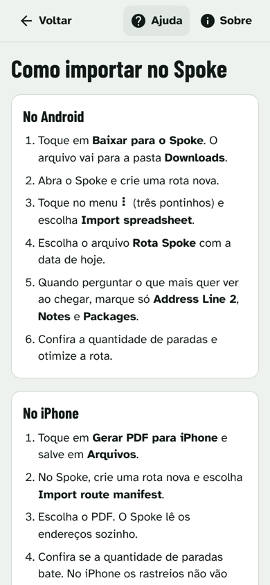

# Rota Fácil

[](https://github.com/Victor-Novakoski/rota-facil/actions/workflows/ci.yml)

App web gratuito que transforma a planilha de entregas do dia num arquivo pronto para o app de rotas, sem nenhum dado sair do celular do entregador.

<p>
  
  
  
</p>

<sub>Prints feitos com o exemplo embutido no app, com endereços inventados.</sub>

## O que dá para fazer

- Abrir a planilha .xlsx que a base manda (compatível com planilhas da iMile).
- Ver os endereços já arrumados: rua e número de um lado, complemento do outro.
- Ver os pacotes do mesmo endereço juntos numa parada só, com todos os rastreios.
- Conferir os avisos em amarelo (sem número, sem localização, endereço corrigido) e marcar cada um como conferido.
- Baixar o arquivo para importar no Spoke: planilha no Android, lista em PDF no iPhone.
- Seguir o passo a passo de importação dentro do app.
- Instalar na tela inicial e usar sem internet.

## Destaques técnicos

- **Privacidade por construção.** Não existe servidor. A planilha é lida e convertida no navegador; fontes e bibliotecas vão dentro do app, então a página não chama nenhum outro site. Uma Content Security Policy faz o próprio navegador barrar qualquer envio para fora, e um teste no navegador confere isso.
- **Conferência que bloqueia.** Depois de gerar o arquivo, o app relê o que gravou e compara com a planilha de entrada: total de pacotes, cada rastreio exatamente uma vez, CEP, cidade, estado, números do endereço e coordenadas. Se algo não bater, o download não é liberado.
- **Regras de endereço testadas com casos reais** (com dados inventados): complemento antes do número ("apto 91 430"), número repetido, rua sem número, "7 de Setembro" que não é número da casa, "Centro" sobrando no fim.
- **Perfis plugáveis.** Uma transportadora nova ou um app de rota novo é um arquivo de perfil. O motor não muda.
- **Motor separado da tela.** `src/core` é TypeScript puro, sem React, testado sozinho. A tela carrega o motor só quando o entregador abre uma planilha.
- **Feito para a rua.** Botão principal sempre ao alcance do polegar, alto contraste para o sol, fontes de alta legibilidade e modo escuro automático.

## Como funciona

```
planilha .xlsx ─► ler (perfil da transportadora) ─► limpar endereço ─► agrupar por endereço + CEP
                                                                              │
          download .xlsx / PDF ◄── conferência (relê o arquivo) ◄── montar arquivo (perfil do app de rota)
```

Detalhes em [docs/ARCHITECTURE.md](docs/ARCHITECTURE.md).

## Stack

| Parte | Escolha |
| --- | --- |
| Tela | React 19 + TypeScript |
| Build | Vite, com PWA (vite-plugin-pwa) |
| Planilhas | SheetJS 0.20.3 |
| PDF | jsPDF |
| Testes | Vitest, Testing Library e Playwright |
| Lint | ESLint (typescript-eslint) |
| Hospedagem e CI | GitHub Pages e GitHub Actions |

## Como rodar

Precisa de Node 20 ou mais novo.

```bash
make setup   # instala as dependências (npm ci)
make dev     # abre em http://localhost:5173
make help    # lista todos os comandos
```

## Roteiro de 5 minutos

1. Rode `make dev` e abra http://localhost:5173 (no computador, use o modo celular do navegador).
2. Passe pelas 3 telas de boas-vindas ou toque em **Pular**.
3. Toque em **Ver como funciona com um exemplo**. Devem aparecer **10 pacotes, 8 paradas e 5 avisos**, com a faixa verde "Conferido: 10 pacotes, nenhum perdido".
4. Em **Avisos para conferir**, toque em **Marcar como conferido** na parada 3. A contagem de avisos cai para 4.
5. Abra **Endereços com vários pacotes**: a Rua das Flores, 120 tem 3 pacotes e os 3 complementos.
6. Toque em **Baixar para o Spoke** e abra o arquivo: os cabeçalhos são `Address Line 1 … Notes`.
7. Volte em **Nova planilha** e abra `src/core/fixtures/exemplo-imile-ficticio.xlsx`. O resultado é o mesmo do exemplo.
8. Abra uma planilha qualquer que não seja da iMile: aparece o erro com as colunas que faltam, e nada é gerado.

## Testes

```bash
make test       # motor e telas (Vitest)
make test-e2e   # fluxo completo no navegador (Playwright)
make lint       # ESLint sem warnings e tipos
```

Para testar com uma planilha real **sem colocá-la no repositório**:

```bash
REAL_SHEET="/caminho/da/planilha.xlsx" REAL_EXPECT="57/46" npm test
```

Planilhas reais têm endereços de clientes e nunca vão para o GitHub. O `.gitignore` bloqueia `.xlsx` fora de `src/core/fixtures/`.

## Estrutura de pastas

```
src/core/              motor: endereço, agrupamento, conferência, arquivos
  carriers/            um perfil por transportadora
  route-apps/          um perfil por app de rota
  fixtures/            planilhas de teste inventadas
src/ui/                telas e componentes React
e2e/                   testes no navegador
docs/                  documentação do projeto
```

## Decisões

As principais estão em [docs/MEMORY.md](docs/MEMORY.md): por que não há servidor, por que React + Vite e não Next.js, por que o SheetJS vem do pacote oficial e como cada regra de endereço foi escolhida.

## Documentação

- [PRD](docs/PRD.md): problema, público e funcionalidades
- [TASKS](docs/TASKS.md): etapas e backlog
- [ARCHITECTURE](docs/ARCHITECTURE.md): fluxo, stack e pastas
- [DESIGN](docs/DESIGN.md): cores, tipografia, componentes e acessibilidade
- [RULES](docs/RULES.md): regras do projeto e definição de pronto
- [SECURITY](docs/SECURITY.md): riscos e como são tratados
- [MEMORY](docs/MEMORY.md): decisões e o porquê
- [CHANGELOG](CHANGELOG.md): o que mudou em cada versão

## Próximos passos

- Teste na rua com entregadores de verdade, no Android e no iPhone.
- Outros apps de rota que aceitem rotas grandes no plano gratuito.
- Outras transportadoras: Loggi, J&T, Shopee e Mercado Envios.

O Rota Fácil é independente e não tem ligação com a iMile, com o Spoke nem com nenhuma transportadora.
